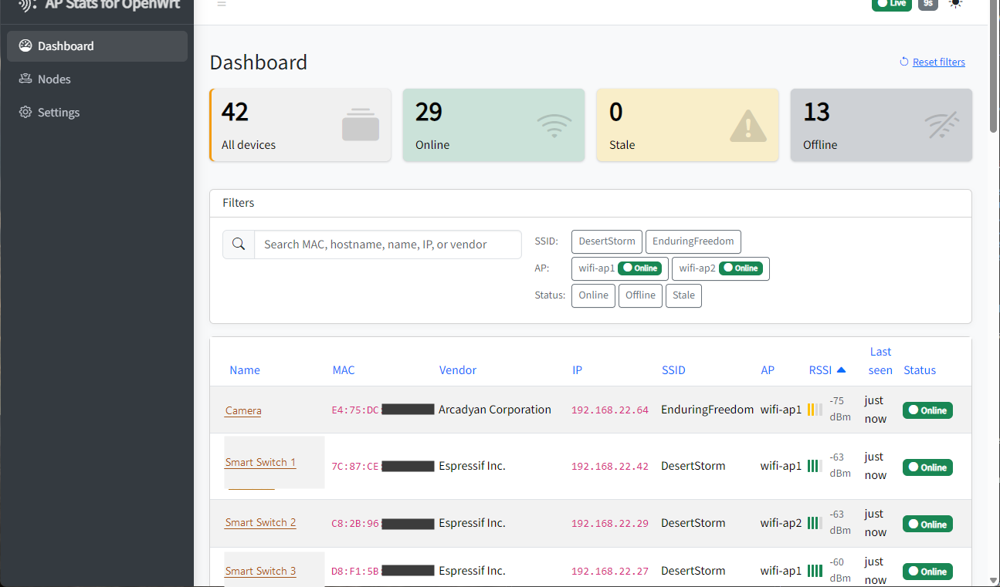

<div align="center">


# AP Stats for OpenWrt

**A self-hosted, Docker-native dashboard that shows you — in real time — every WiFi station connected to every WLAN on every OpenWRT access point you operate.**

[](https://dotnet.microsoft.com/)
[](https://learn.microsoft.com/aspnet/core/blazor/)
[](#try-it-in-60-seconds)
[](#architecture-at-a-glance)
[](Directory.Build.props)
[](LICENSE)

---



*Live multi-AP, multi-WLAN station view. The native LuCI UI in AP mode does not present this information cleanly across access points — this dashboard fills that gap.*

</div>

---

## Why this exists

If you run more than one OpenWRT access point, you already know the problem:

- LuCI in AP mode shows you **one AP at a time**.
- It does not give you a single pane of glass for **which station is on which WLAN on which AP**, in real time.
- Hunting through `iwinfo`, `iw dev`, and `ip neigh show` over SSH on every AP, every time you want to answer *"is that device actually associated, and to which radio?"*, gets old fast.

**AP Stats for OpenWrt** is a single Docker container that polls each of your OpenWRT APs over SSH and renders the combined live state through a Blazor InteractiveServer UI. Open the dashboard in a browser and you see everything; close the tab and the polling pauses so your APs don't pay for cycles nobody is looking at.

## Features

- **Live multi-AP dashboard.** Server-pushed updates over SignalR — no manual refresh, no client polling.
- **WLAN + station discovery.** SSID, channel, width, BSSID, TxPower per WLAN; MAC, IP, hostname, Tx/Rx bitrate, RSSI, online/offline, last seen, first seen per station.
- **Active enrichment.** Batched `arping` sweep with `ping` fallback, reverse-DNS resolution against each AP's configured resolver, random-MAC detection from the U/L bit, AssignedName / Hostname / MAC display cascade.
- **Per-station detail page.** Rename, delete, mark as random-MAC, and (v0.11) disconnect-from-AP — a write-side SSH action to nudge sticky clients to re-associate.
- **First-run wizard.** Set the UI password, declare your first OpenWRT AP, choose which WLANs to monitor, land on the dashboard. No config files to hand-edit.
- **Visitor-gated polling.** While no browser session is open, the background poller is suspended; it resumes the moment you open the dashboard. A separate `/health` HTTP endpoint stays available for external monitoring and does not count toward the gate.
- **Pi.Alert-style polish.** Clickable KPI tiles bidirectionally synced with filter chips, AdminLTE 4 native dark mode, Bootstrap 5 toast notifications for AP/station events, localStorage-backed user preferences, custom WiFi-stylized SVG branding.
- **Encrypted credentials at rest.** Each AP password is encrypted with ASP.NET Data Protection; the optional UI password is stored as a PBKDF2 hash.
- **Single image, single SQLite file.** Stop the container, copy `/data`, and your entire deployment is portable.

## Try it in 60 seconds

### Option A — `docker run`

```sh
docker run -d \
  --name apstatsforopenwrt \
  -p 8080:8080 \
  -v apstatsforopenwrt-data:/data \
  -v apstatsforopenwrt-logs:/logs \
  --restart unless-stopped \
  apstatsforopenwrt:latest
```

### Option B — Docker Compose

A ready-to-use [`docker-compose.yml`](docker-compose.yml) ships in this repo:

```sh
docker compose up -d
docker compose logs -f       # follow logs
docker compose down          # stop (volumes preserved)
```

Then open **<http://localhost:8080>** in your browser. The first-run wizard takes over — no environment variables required.

### Building the image locally

The repo ships a `Dockerfile`. From the repo root:

```sh
docker build -t apstatsforopenwrt:latest .
```

(Or just let `docker compose up -d` build it for you on first start.)

## Volumes & ports

| Mount / Port | Purpose | Persist? |
|---|---|---|
| `/data` | SQLite database at `/data/AP-Stats-for-OpenWrt.db` and the ASP.NET Data Protection keyring at `/data/keys`. Holds your APs, the UI password hash, the encrypted SSH credentials, and the operator's onboarding state. | **Yes — required.** |
| `/logs` | Serilog daily-rolling files (`/logs/ap-stats-for-openwrt-*.log`), 7-day retention. | Optional; recommended. |
| `8080/tcp` | HTTP — Blazor UI + `/health` JSON endpoint. | n/a |

> **Note on named volumes vs bind mounts:** Named volumes (the Compose default) inherit the in-image `chown -R app:app` cleanly. If you use a bind mount on Linux, `chown -R 1654:1654` the host path first or the container's non-root user will not be able to write.

## First-run onboarding

1. Visit `http://localhost:8080`.
2. The setup wizard asks you to set an optional UI password (PBKDF2-hashed; skip to leave the site open inside your LAN).
3. Declare your first OpenWRT AP: hostname or IP, SSH username, SSH password. The password is encrypted at rest immediately.
4. Pick which WLANs on that AP you want to monitor.
5. You land on the live dashboard. New APs and per-WLAN toggles are managed from the Settings page afterwards.

There is no `config.yml`, no `.env`, no first-time CLI dance. Everything is configured through the UI.

## Requirements

### Host

- **Docker** (any recent version supporting compose v2).
- **One open TCP port** — defaults to 8080; remap freely.
- Network reachability from the container to each declared AP's SSH port (typically 22 inside your LAN).

### Access points

- **OpenWRT** with the standard CLI surface — `iwinfo`, `iw dev`, `ip neigh show`. Tested against modern OpenWRT releases (the SSH transport speaks Dropbear cleanly without any manual cipher configuration via SSH.NET 2025.1.x).
- **SSH access** for a user that can run `iwinfo` and `iw dev`. Read-only is sufficient for discovery; the optional v0.11 *Disconnect station* action additionally requires the SSH user to be able to run the deauth command.
- **DHCP server location is up to you.** If your AP runs `dnsmasq` and serves DHCP, `ip neigh show` plus reverse-DNS will resolve hostnames cleanly; if your DHCP server lives elsewhere, IP/hostname discovery is best-effort and may leave some fields blank — that is a known and accepted limitation.

## Architecture at a glance

One .NET 10 process, three cooperating planes inside a single container:

1. **SSH polling plane** — A `BackgroundService` (`PollingHostedService`) drives a `PollOrchestrator`, which fans out per-AP `NodePoller` tasks over SSH.NET, parses the output, and returns POCOs.
2. **Persistence plane** — `IDbContextFactory<DatabaseContext>` over EF Core 10 against the SQLite file at `/data/AP-Stats-for-OpenWrt.db`. Migrations run automatically at startup; only the orchestrator writes to the DB, inside one transaction per cycle (single-writer invariant).
3. **UI plane** — Blazor InteractiveServer with an AdminLTE 4 chrome. A singleton `PollNotifier` publishes cycle-complete events; component subscriptions push updates to every connected browser via SignalR.

A singleton `CircuitTracker` (Interlocked counter + a re-armable `TaskCompletionSource`) gates the polling plane on browser presence. The `/health` endpoint is a plain `MapHealthChecks` route — structurally unable to increment the gate.

Deeper reading: [`CLAUDE.md`](CLAUDE.md) (conventions) and [`.planning/PROJECT.md`](.planning/PROJECT.md) (living project context).

## Health & observability

The container exposes a plain HTTP `/health` endpoint on port 8080 for liveness and readiness probes. The response shape is locked:

```json
{
  "status": "Healthy",
  "components": { "db": "Healthy", "dataProtection": "Healthy" },
  "lastPollAge": "00:00:14.3210000"
}
```

- The endpoint does **not** count toward the visitor gate, so external monitors will not keep the polling cycle armed.
- Serilog writes structured logs to both stdout (consumed by `docker logs`) and `/logs/ap-stats-for-openwrt-*.log` (daily-rolling, 7-day retention, compact JSON formatter).

## Security posture

- **AP passwords:** encrypted at rest via ASP.NET Data Protection, with the keyring persisted under `/data/keys` (`SetApplicationName("ApStatsForOpenWrt")`). Surviving container recreation requires keeping the `/data` volume.
- **UI password:** stored as a PBKDF2 hash (`PasswordHasher<T>`) — one-way; recoverable only by clearing the row in the SQLite `AppSetting` table.
- **No telemetry, no phone-home.** The app makes no outbound HTTP calls; the only network egress is SSH to each declared AP.
- **Single shared site password.** This is a small-scale, self-hosted tool — there is no multi-user / RBAC model, and there is no email-based password reset. That is a deliberate scope decision.
- **Read-only by design** for the polling plane. The only write-side path against APs is the explicit, confirmation-gated *Disconnect station* action (v0.11), which issues a single deauth/disassoc command over SSH.

## Roadmap

This is an actively developed project. The full living roadmap, milestone history, and the next milestone's charter live in [`.planning/PROJECT.md`](.planning/PROJECT.md). Highlights:

- **v0.9** — Foundation, SSH probing, live UI, onboarding, visitor-gated polling, packaging, Pi.Alert-style polish.
- **v0.9.1** — Active station enrichment (IP via `arping`, hostname via reverse DNS, random-MAC detection).
- **v0.9.2** — Per-station "first seen" timestamp.
- **v0.10** — Rebrand to *AP Stats for OpenWrt* (internal).
- **v0.11** — Operator actions & polish: polling-countdown state machine, on-demand *Run now* enrichment trigger, first-cycle enrichment concurrency audit, *Disconnect station* write-side SSH action.
- **v1.0** — First public release.

Beyond v1.0, candidates on the deferred list include time-series sighting history, CSV export, station tags, per-AP/WLAN summary cards, and a chiseled base image. See PROJECT.md → *Out of Scope (deferred — vNext candidates)*.

## Contributing

Contributions are welcome. This repo uses an opinionated planning workflow ([`get-shit-done`](CLAUDE.md#gsd-workflow-enforcement)) — every change lives in either a planned phase under `.planning/phases/` or a small ad-hoc task under `.planning/quick/`. If you want to propose a change:

1. Open an issue describing the use case or bug.
2. For non-trivial work, expect the conversation to settle on a phase or quick-task scope before code lands.
3. Code changes go through the existing CI: build, full xUnit v3 + bUnit test suite, and a 80% line + branch coverage gate enforced by `Microsoft.Testing.Extensions.CodeCoverage` (Cobertura).

Conventions, anti-patterns, and architectural invariants are documented in [`CLAUDE.md`](CLAUDE.md).

## License

This project is released under the [PolyForm Noncommercial License 1.0.0](LICENSE). In plain terms: you may use, study, modify, and redistribute the source — including modified versions — for any noncommercial purpose, provided you keep the `Required Notice:` attribution line that names the original author. Commercial use is not granted by this license; contact the maintainer if you need a separate commercial arrangement.

PolyForm Noncommercial is a *source-available* license, not an OSI-approved open-source license — the noncommercial restriction is incompatible with the OSI definition. The canonical license text is hosted at <https://polyformproject.org/licenses/noncommercial/1.0.0>; the verbatim copy that governs this repository lives in [`LICENSE`](LICENSE).

## Trademarks

*OpenWRT*, *LuCI*, *Docker*, *.NET*, *Blazor*, *ASP.NET*, *SQLite*, *EF Core*, *AdminLTE*, *Pi.Alert*, *SSH.NET*, *Serilog*, and any other product, project, or company names referenced in this repository are trademarks or registered trademarks of their respective owners. Their use here is for identification purposes only and does not imply any affiliation with, sponsorship by, or endorsement from those owners. *AP Stats for OpenWrt* is an independent project that monitors OpenWRT access points over SSH; it is not affiliated with the OpenWRT project.

---

<div align="center">
<sub>Built with .NET 10 + Blazor + SSH.NET. Self-hosted, single-binary-ish, no cloud dependencies.</sub>
</div>
