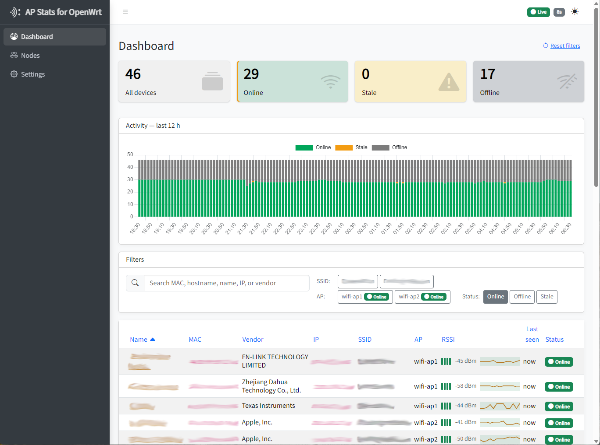

<div align="center">


# AP Stats for OpenWrt

**A self-hosted, Docker-native dashboard that shows you — in real time — every WiFi station connected to every WLAN on every OpenWRT access point you operate.**

[](https://github.com/mdima/ap-stats-for-openwrt/actions/workflows/ci.yml)
[](https://dotnet.microsoft.com/)
[](https://learn.microsoft.com/aspnet/core/blazor/)
[](#quickstart)
[](Directory.Build.props)
[](LICENSE)

---



*Live multi-AP, multi-WLAN station view. The native LuCI UI in AP mode does not present this information cleanly across access points — this dashboard fills that gap.*

</div>

---

## Why this exists

If you run one or more OpenWRT access points, you already know the problem: LuCI in AP mode shows you **one AP at a time**, and there is no single pane of glass for **which station is on which WLAN on which AP**, in real time. Hunting through `iwinfo`, `iw dev`, and `ip neigh show` over SSH on every AP gets old fast.

**AP Stats for OpenWrt** is a single Docker container that polls each of your OpenWRT APs over SSH and renders the combined live state through a Blazor InteractiveServer UI. Open the dashboard in a browser and you see everything; close the tab and the polling pauses so your APs don't pay for cycles nobody is looking at.

## Features

- **Live multi-AP dashboard** — server-pushed updates over SignalR; no manual refresh.
- **WLAN + station discovery** — SSID, channel, width, BSSID, TxPower per WLAN; MAC, IP, hostname, Tx/Rx bitrate, RSSI, online/offline, last/first seen per station.
- **Active enrichment** — batched `arping` sweep with `ping` fallback, reverse-DNS resolution, random-MAC detection, AssignedName / Hostname / MAC display cascade.
- **Per-station detail page** — rename, delete, mark as random-MAC, and a confirmation-gated *Disconnect station* write-side SSH action.
- **First-run wizard** — set the UI password, declare your first AP, choose WLANs to monitor. No config files to hand-edit. See [first-boot](docs/first-boot.md).
- **Visitor-gated polling** — If the historical data service is disabled, the background poller is suspended whenever no browser session is open, and resumes as soon as you open the dashboard. A separate `/health` HTTP endpoint remains available for external monitoring and does not count toward the gate.
- **Encrypted credentials at rest** — each AP password is encrypted with ASP.NET Data Protection; the optional UI password is stored as a PBKDF2 hash. See the [threat model](docs/threat-model.md).
- **Single image, single SQLite file** — stop the container, copy `/data`, and your entire deployment is portable. See [backup](docs/backup.md).
- **Automatic update check** — a daily, visitor-gated query to the GitHub Releases API surfaces a newer published release via a calm navbar badge, a one-time toast, and a Settings card. Notify-only; toggle it off for zero outbound traffic.

## Quickstart

A ready-to-use [`docker-compose.yml`](docker-compose.yml) ships in this repo:

```yaml
services:
  apstatsforopenwrt:
    image: michele73/ap-stats-for-openwrt:1.0.0
    container_name: apstatsforopenwrt
    restart: unless-stopped
    ports:
      - "8080:8080"
    volumes:
      - apstatsforopenwrt-data:/data
      - apstatsforopenwrt-logs:/logs
    healthcheck:
      test: ["CMD", "curl", "-fsS", "http://localhost:8080/health"]
      interval: 30s
      timeout: 5s
      start_period: 15s
      retries: 3

volumes:
  apstatsforopenwrt-data:
  apstatsforopenwrt-logs:
```

```sh
docker compose up -d
```

Or with `docker run`:

```sh
docker run -d \
  --name apstatsforopenwrt \
  -p 8080:8080 \
  -v apstatsforopenwrt-data:/data \
  -v apstatsforopenwrt-logs:/logs \
  --restart unless-stopped \
  michele73/ap-stats-for-openwrt:1.0.0
```

Then open **<http://localhost:8080>** and the [first-run wizard](docs/first-boot.md) takes over — no environment variables required.

### Volumes & ports

| Mount / Port | Purpose | Persist? |
|---|---|---|
| `/data` | SQLite database at `/data/AP-Stats-for-OpenWrt.db` and the ASP.NET Data Protection keyring at `/data/keys`. Holds your APs, the UI password hash, the encrypted SSH credentials, and onboarding state. | **Yes — required.** |
| `/logs` | Serilog daily-rolling files (`/logs/ap-stats-for-openwrt-*.log`), 7-day retention. | Optional; recommended. |
| `8080/tcp` | HTTP — Blazor UI + `/health` JSON endpoint. | n/a |

> **Named volumes vs bind mounts:** named volumes (the Compose default) inherit the in-image `chown -R app:app` cleanly. With a bind mount on Linux, `chown -R 1654:1654` the host path first or the container's non-root user cannot write.

## Supported OpenWRT versions

The honest state of device coverage. The lowest tier is an **invitation to report**, not "Unsupported" — community fixtures are how the matrix grows. No version is claimed tested or verified without hardware or fixture evidence.

| Tier | Versions | Evidence |
|---|---|---|
| ✅ Tested on hardware | **23.05** | operator's live APs |
| 🧪 Fixture-verified | **23.05-SNAPSHOT, 22.03, 21.02** | parser tests vs captured real `iwinfo`/`iw`/`ip-neigh`/`nslookup` output (point: 22.03.7, 21.02.7) |
| 🌐 Community-verified | everything else | none yet — **Should work — untested, please report results** |

Running a version not in the matrix? Please [open an AP-version support report](../../issues/new?template=ap_version_support.yml) — it walks you through capturing redacted SSH fixtures with the bundled `tools/FixtureCapture`, which is how new versions get verified.

## Documentation

Topic guides live under [`docs/`](docs/README.md):

- [First-boot walkthrough](docs/first-boot.md) — the setup wizard, volumes & ports, the `/health` endpoint, and access-point requirements.
- [Running behind a reverse proxy](docs/reverse-proxy.md) — `ForwardedHeaders` trust, the `Csp__ConnectSrc` knob, secure-cookie behaviour, HTTP-on-LAN posture.
- [Threat model](docs/threat-model.md) — deployment posture, the security hardening, and documented boundaries (including the plaintext Data Protection keyring on `/data`).
- [Backing up /data](docs/backup.md) — manual backups and the automatic pre-migration `.bak` set with its restore procedure.
- [Upgrading](docs/upgrading.md) — the `docker compose pull` upgrade path, automatic schema migration, and the rolling `.bak` safety net.
- [Dropbear & SubnetScanRanges](docs/dropbear-subnet-note.md) — why stock Dropbear breaks subnet auto-derivation and how to set an explicit `SubnetScanRanges`.

## Roadmap

- **v0.9** — Foundation, SSH probing, live UI, onboarding, visitor-gated polling, packaging, Pi.Alert-style polish.
- **v0.9.1** — Active station enrichment (IP via `arping`, hostname via reverse DNS, random-MAC detection).
- **v0.9.2** — Per-station "first seen" timestamp.
- **v0.10** — Rebrand to *AP Stats for OpenWrt* (internal).
- **v0.11** — Operator actions & polish: polling-countdown state machine, on-demand *Run now* enrichment trigger, *Disconnect station* write-side SSH action.
- **v0.12** — Security hardening: login throttling + password policy, session rotation on password change, anti-takeover onboarding, baseline response headers, opt-in reverse-proxy header trust, SSH host-key TOFU UX + algorithm visibility, hardened disconnect command. See the [threat model](docs/threat-model.md).
- **v0.13** — Automatic update check: a daily, visitor-gated query to the GitHub Releases API surfacing a newer published release via a navbar badge, a one-time toast, and a Settings card. Notify-only.
- **v1.0** — First public release. 🎉

Beyond v1.0, candidates on the deferred list include time-series sighting history, CSV export, station tags, per-AP/WLAN summary cards, and a chiseled base image. Have an idea? [Open a feature request](../../issues/new?template=feature_request.yml).

## Contributing

Contributions are welcome — bug fixes, new device/version support, documentation improvements, and well-scoped features. See [`CONTRIBUTING.md`](CONTRIBUTING.md) for the fork → PR → CI flow, the inbound = outbound GPL-3.0 licensing of contributions, and the AP-version fixture pipeline that grows the support matrix.

Security reports go through GitHub private vulnerability reporting — see [`SECURITY.md`](SECURITY.md).

## License

This project is open source under the [GNU General Public License v3.0](LICENSE). In plain terms: you are free to use, study, modify, and redistribute the software — including modified versions — provided that any distributed derivative stays under GPL-3.0 and keeps the copyright and license notices intact. The canonical license text is hosted at <https://www.gnu.org/licenses/gpl-3.0.txt>; the verbatim copy that governs this repository lives in [`LICENSE`](LICENSE).

## Trademarks

*OpenWRT*, *LuCI*, *Docker*, *.NET*, *Blazor*, *ASP.NET*, *SQLite*, *EF Core*, *AdminLTE*, *Pi.Alert*, *SSH.NET*, *Serilog*, and any other product, project, or company names referenced in this repository are trademarks or registered trademarks of their respective owners. Their use here is for identification purposes only and does not imply any affiliation with, sponsorship by, or endorsement from those owners. *AP Stats for OpenWrt* is an independent project that monitors OpenWRT access points over SSH; it is not affiliated with the OpenWRT project.

---

<div align="center">
<sub>Built with .NET 10 + Blazor + SSH.NET. Self-hosted, single-binary-ish, no cloud dependencies.</sub>
</div>
